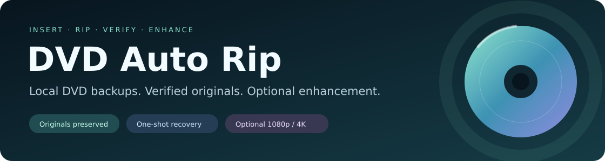
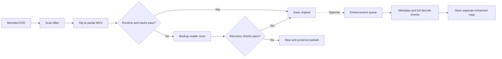
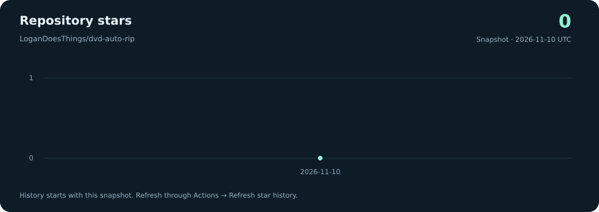

<p align="center">
  
</p>

<p align="center">
  <a href="https://github.com/LoganDoesThings/dvd-auto-rip/actions/workflows/tests.yml"></a>
  
  
  
</p>

<p align="center"><strong>A local Ubuntu DVD ripper that keeps the original, checks the result, and tries recovery once.</strong></p>
<p align="center"><a href="#quick-start">Quick start</a> · <a href="docs/usage.md">User guide</a> · <a href="#optional-enhancement">Enhancement</a> · <a href="docs/development-notes.md">Development notes</a> · <a href="#star-history">Star history</a></p>

## What it does

| Capability | What you get |
| --- | --- |
| Automatic DVD watching | Mounted movie DVDs become separate MKV files for qualifying titles. |
| Output validation | Runtime and track checks before a partial file receives its final name. |
| One-shot recovery | A fresh DVD-reading method after a failed scan, encode, or output check. |
| Original preservation | Separate partials, completed-title history, and no overwrite of existing movies. |
| Optional enhancement | Separate 1080p SDR or SDR-derived 1080p/4K HDR copies, with a serial job queue. |
| Desktop or terminal | GTK controls, headless watching, and enhancement status/queue commands. |

**Everything processes locally.** Movie files, logs, account state, and DVD keys are excluded from this repository.

## Quick start

Tested on **Ubuntu 24.04** with Python/GTK, HandBrakeCLI, and FFmpeg.

```bash
sudo apt install git python3 python3-gi gir1.2-gtk-3.0 handbrake-cli ffmpeg
git clone https://github.com/LoganDoesThings/dvd-auto-rip.git
cd dvd-auto-rip
/usr/bin/python3 -m unittest -v
/usr/bin/python3 install.py
~/.local/bin/dvd-auto-rip
```

A working DVD-reading/decryption stack is required separately; external binaries and keys are not bundled. The installer creates a menu launcher and login startup entry. Use `install.py --no-autostart` to skip startup. Keep the checkout in place after installation.

1. Insert the DVD and let Ubuntu mount it. Open it in Files if necessary.
2. The watcher scans titles and saves movies under `~/Videos/DVD Rips/`.
3. Check playback and captions after completion. Failed attempts remain clearly marked `.partial.mkv`.

For terminal watching, use `~/.local/bin/dvd-auto-rip --headless`. [Full installation and operating guide →](docs/usage.md)

## Rip, recover, verify



Recovered and enhanced outputs also require a **complete video/all-audio decoding check**. Stop/Quit never starts another recovery attempt. Ambiguous scans with 20 or more long titles require an explicit title choice. [Recovery and title selection →](docs/usage.md#long-scans-and-ambiguous-dvd-titles)

## Optional enhancement

Enhancement is **off by default**. Choose a preset and destination, then use **Enhance a saved movie…** or opt into enhanced copies after verified rips.

| Preset | Output | Color |
| --- | --- | --- |
| 1080p SDR | 1920 × 1080 · HEVC Main 10 | BT.709 SDR |
| 1080p HDR | 1920 × 1080 · HEVC Main 10 | BT.2020/PQ · SDR-converted |
| 4K HDR | 3840 × 2160 · HEVC Main 10 | BT.2020/PQ · SDR-converted |

All original audio, subtitles, attachments, and chapters are retained. Aspect ratio is preserved, including 4:3 material. Jobs keep a disk-space reserve, detect missing output drives, and run separately from ordinary ripping.

**A DVD upscale remains limited by the DVD source.** HDR presets creatively convert SDR; they do not recover studio HDR detail or provide HDR certification. Long conversions can take many hours. [Enhancement controls and limits →](docs/usage.md#optional-enhanced-movie-copies)

## Documentation

- [User guide](docs/usage.md): installation, mounting, controls, recovery, title selection, storage, and CLI commands.
- [Development notes](docs/development-notes.md): design decisions, real-disc lessons, and verification evidence.
- [Repository maintenance](docs/maintenance.md): tests, chart updates, and repository structure.

## Checks

The local suite contains **63 regression tests**. GitHub Actions runs the tests on pushes and pull requests; the badge above reflects its actual result.

```bash
/usr/bin/python3 -m unittest -v
```

Short end-to-end 4K HDR, retained-track/chapter, GTK settings, and aspect-ratio checks have also passed locally. Full-film enhancement quality still needs review on the intended screen. [Validation details →](docs/development-notes.md)

## Star history

<a href="https://github.com/LoganDoesThings/dvd-auto-rip/stargazers"></a>

The chart records real snapshots, starting with the current count. Refresh it with **Actions → Refresh star history → Run workflow**, or run the [update command](docs/maintenance.md#refresh-the-star-chart) locally. It does not invent historical growth or change repository visibility.
